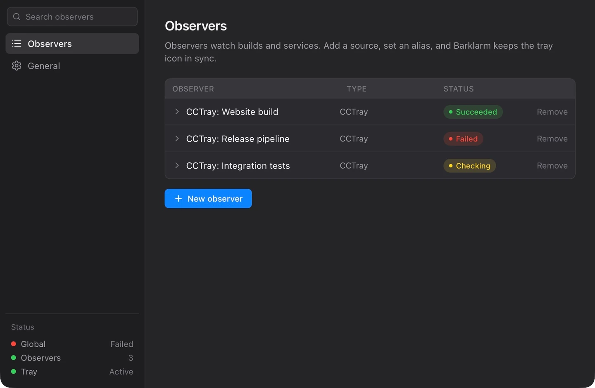

Select **Configure** from the [tray menu](/docs/application/menu) to open the Barklarm window.

Use **Observers** to search your monitors, expand a row to edit it, or add a source with **New observer**. Open **General** for app settings.

Find the fields for your service in the [configuration guides](/docs/configuration).
