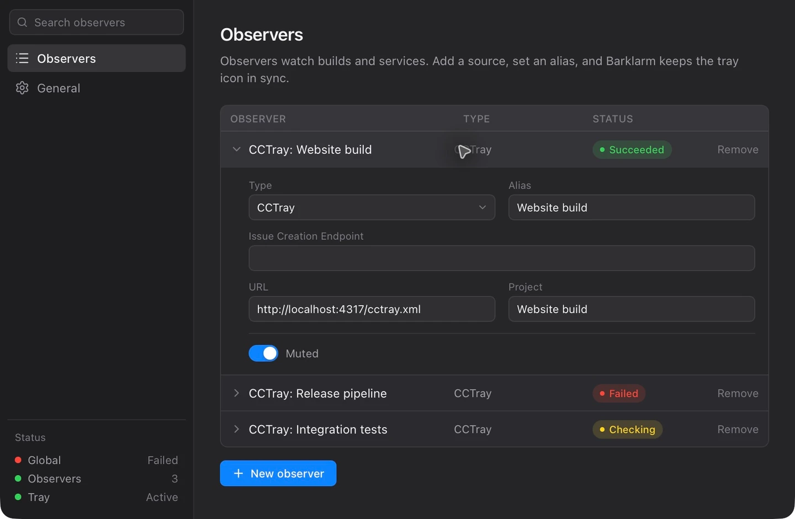

Open **Configure** from the Barklarm tray menu, then select **New observer**. Choose an integration and give it an alias so you can recognize it in your tray.

## Integration guides

- [GitHub Actions](/docs/configuration/github-actions)
- [Azure DevOps](/docs/configuration/azure-devops)
- [Datadog Monitors](/docs/configuration/datadog-monitors)
- [Sentry](/docs/configuration/sentry)
- [New Relic](/docs/configuration/new-relic)
- [CCTray](/docs/configuration/cctray)

You can also choose Bitbucket Pipelines, Graylog, Opsgenie, or Grafana (Alpha) from the observer type list.
